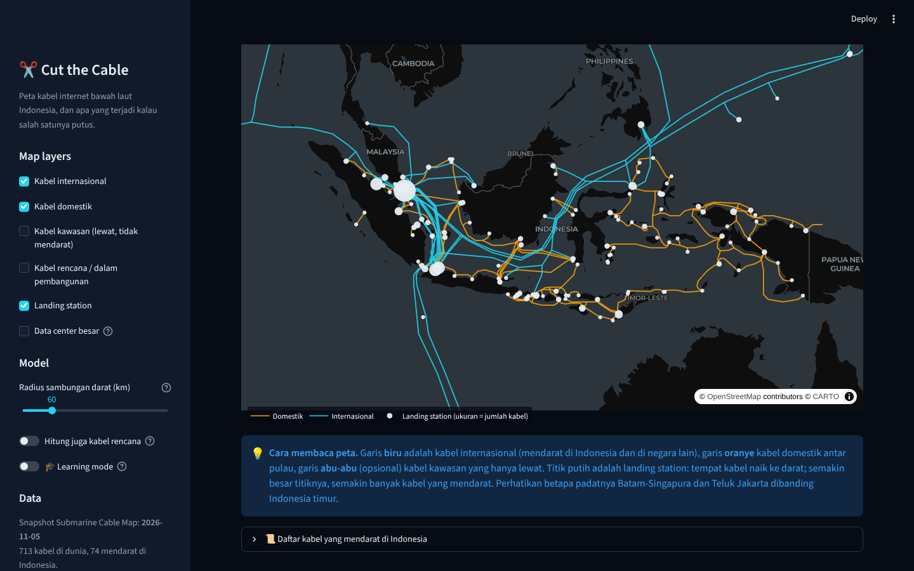
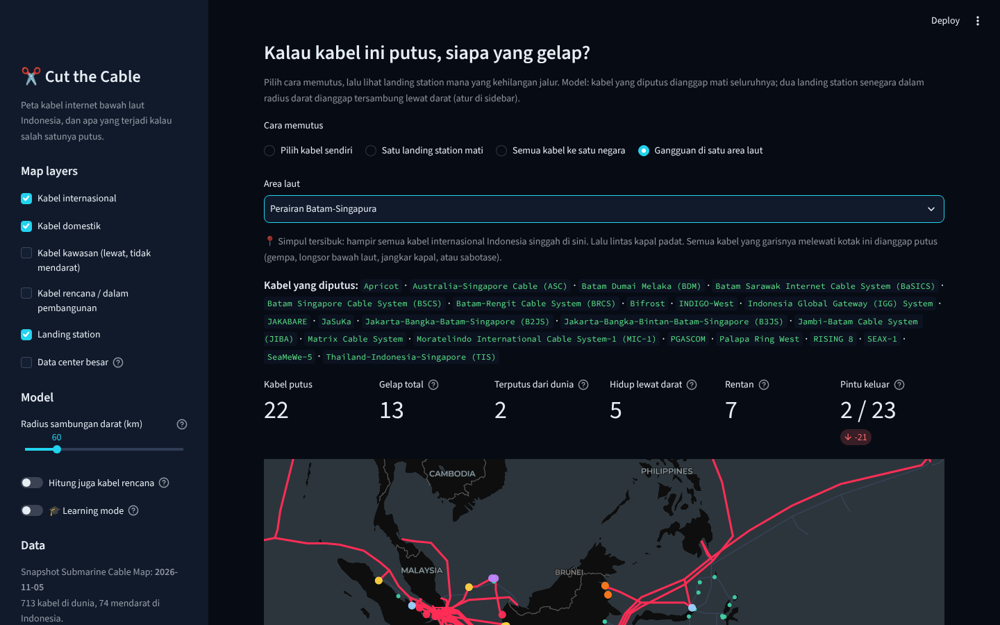
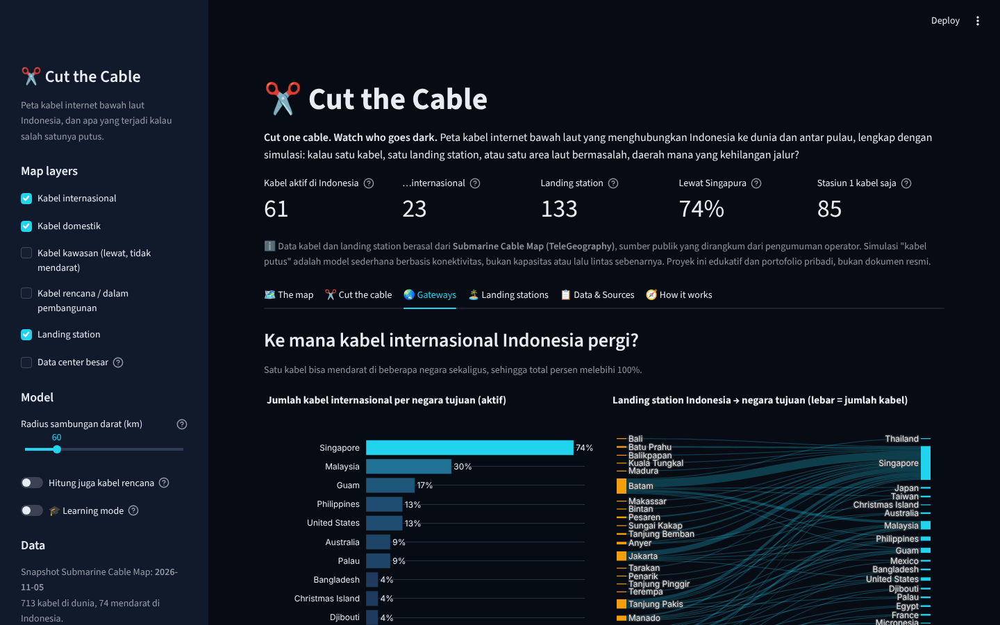
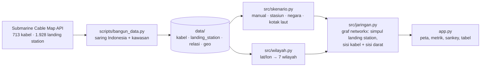

# ✂️ Cut the Cable

[](https://github.com/Avalon2222/cut-the-cable/actions/workflows/tests.yml) [](https://www.python.org/) [](LICENSE) [](https://cut-the-cable.streamlit.app)

> Peta kabel internet bawah laut yang menghubungkan Indonesia ke dunia dan antar pulau, lengkap dengan simulasi:
> **kalau satu kabel, satu landing station, atau satu area laut bermasalah, daerah mana yang kehilangan jalur?**
> Dibangun dari data publik Submarine Cable Map (TeleGeography) dengan Python, pandas, networkx, Plotly, dan Streamlit.

*Cut one cable. Watch who goes dark. An interactive map of the submarine cables that connect Indonesia to the world
and to itself, with a what-if simulator: cut a cable, knock out a landing station, or hit one stretch of sea, and see
which coastal towns lose their route out. Built from TeleGeography's public cable data with Python, networkx, Plotly
and Streamlit.*

**🚀 Coba langsung di browser:** [cut-the-cable.streamlit.app](https://cut-the-cable.streamlit.app)



> ℹ️ **Disclaimer.** Data kabel dan landing station berasal dari **Submarine Cable Map (TeleGeography)**, sumber publik
> yang dirangkum dari pengumuman operator; jalur dan titik pendaratan adalah penyederhanaan, bukan koordinat presisi.
> Simulasi "kabel putus" adalah model konektivitas sederhana, bukan model kapasitas atau lalu lintas sebenarnya.
> Proyek ini edukatif dan portofolio pribadi, bukan dokumen resmi, serta tidak berafiliasi dengan instansi mana pun.

## Latar belakang

Hampir semua lalu lintas internet internasional bergerak lewat kabel serat optik di dasar laut, bukan satelit.
Untuk negara kepulauan seperti Indonesia, kabel yang sama juga menjadi tulang punggung antar pulau. Setiap beberapa
bulan ada berita kabel putus: jangkar kapal di Batam, gempa di Selat Makassar, pengerukan di Teluk Jakarta, dan
internet satu kota melambat berhari-hari.

Pertanyaannya sederhana tetapi jarang dijawab dengan data: **kabel apa saja yang menghubungkan Indonesia, lewat mana,
dan apa yang terjadi kalau salah satunya mati?** Ternyata datanya terbuka. TeleGeography memublikasikan daftar kabel,
landing station, pemilik, dan geometri jalurnya lewat API publik. Dengan teori graf dasar, pertanyaan "siapa yang gelap"
bisa dihitung sendiri dalam sepersekian detik. Proyek ini sekaligus menjadi latihan graf (komponen terhubung), geometri
komputasi sederhana (potongan garis vs persegi), dan membuat peta interaktif dari GeoJSON.

## Fitur

| Tab | Isi |
|---|---|
| 🗺️ The map | Semua kabel yang mendarat di Indonesia (internasional biru, domestik oranye) plus kabel kawasan yang hanya lewat, landing station dengan ukuran sesuai jumlah kabel, lapisan data center opsional, sorot satu kabel untuk melihat pemilik, panjang, tahun, dan daftar pendaratannya |
| ✂️ Cut the cable | Simulasi dengan empat cara memutus: pilih kabel sendiri, satu landing station mati, semua kabel ke satu negara, atau gangguan di satu area laut (Selat Sunda, Batam-Singapura, Selat Malaka, Teluk Jakarta, Selat Lombok, Selat Makassar, Laut Sulawesi, Laut Banda). Hasil: peta status per landing station, jumlah "gelap total", "terputus dari dunia", "rentan", pintu keluar internasional yang tersisa, dan rincian per wilayah |
| 🌏 Gateways | Negara tujuan kabel internasional Indonesia dan persentasenya, diagram sankey landing station → negara, serta linimasa tahun siap pakai setiap kabel |
| 🏝️ Landing stations | Landing station per wilayah, berapa persen yang hanya punya satu kabel, sebaran jumlah kabel, dan tabel lengkap |
| 📋 Data & Sources | Sumber, definisi, keterbatasan, dan tombol download CSV/GeoJSON |
| 🧭 How it works | Diagram alur data → graf → simulasi dan peran setiap modul |
| 🎓 Learning mode | Toggle di sidebar: setiap tab menampilkan expander berisi penjelasan, rumus, dan potongan kode |




## Cara menjalankan

```bash
git clone https://github.com/Avalon2222/cut-the-cable.git
cd cut-the-cable
python -m venv .venv && source .venv/bin/activate   # Windows: .venv\Scripts\activate
pip install -r requirements.txt
streamlit run app.py
```

Buka `http://localhost:8501`. Aplikasi membaca snapshot di `data/` sehingga berjalan tanpa internet. Jalankan pengujian
dengan `python -m pytest tests/ -v` (59 tes, tanpa internet). Untuk memperbarui data dari Submarine Cable Map:
`python scripts/bangun_data.py` (±1 menit).

## Cara kerja (ringkas)



| Modul | Yang dilakukan |
|---|---|
| `scripts/bangun_data.py` | Unduh daftar kabel, detail per kabel, dan geometri; saring kabel yang mendarat di Indonesia atau melintas kotak perairan Indonesia; simpan CSV/GeoJSON ringkas |
| `src/muat_data.py` | Baca data dengan tipe yang benar; pencarian kabel ↔ landing station |
| `src/wilayah.py` | Aturan kotak lintang-bujur untuk tujuh wilayah besar |
| `src/skenario.py` | Empat cara memilih kabel yang diputus, termasuk uji ruas garis vs persegi (Liang-Barsky) untuk skenario area laut |
| `src/jaringan.py` | Graf: simpul landing station, sisi untuk setiap pasangan landing station dalam satu kabel, sisi darat untuk tetangga senegara < radius; simulasi, status, ringkasan wilayah, gateway, linimasa |
| `app.py` | UI Streamlit: sidebar, peta Plotly `Scattermap`, metrik, sankey, tabel, learning mode |

Definisi yang dipakai:

- **Kabel internasional** = minimal satu landing station di Indonesia dan satu di luar negeri. **Domestik** = semua di Indonesia.
  **Kawasan** = tidak mendarat di Indonesia tetapi melintas kotak 94–142° BT, 12° LS–8° LU (hanya konteks peta).
- **Putus** = kabel dianggap mati seluruhnya, karena data publik tidak menyimpan segmen mana yang menghubungkan kota mana.
- **Sambungan darat** = dua landing station senegara yang berjarak kurang dari radius (bawaan 60 km) dianggap tersambung
  lewat serat optik darat. Radius bisa diatur 0–300 km di sidebar.
- **Status** setelah pemutusan: *Gelap total* (tidak ada kabel dan tidak ada jalur darat), *Terputus dari dunia* (kelompoknya
  tidak lagi punya jalur ke luar negeri), *Hidup lewat darat*, *Rentan (1 kabel tersisa)*, *Kehilangan jalur*, *Aman*.
- **Pintu keluar internasional** = jumlah kabel internasional berbeda yang masih bisa dicapai dari suatu landing station.

## Data

| Data | Sumber | Keterangan |
|---|---|---|
| Kabel, landing station, pemilik, panjang, RFS, geometri | [Submarine Cable Map](https://www.submarinecablemap.com) (TeleGeography), API publik `api/v3` | Snapshot November 2026: 713 kabel dunia → 74 mendarat di Indonesia (61 aktif, 13 rencana) + 44 kabel kawasan; 146 landing station di Indonesia. Lisensi CC BY-NC-SA 3.0 |
| Pembagian wilayah | `src/wilayah.py` | Aturan buatan sendiri, bukan batas administratif |
| Area laut skenario | `src/skenario.py` | Delapan kotak perkiraan |
| Lokasi data center | [dc-impact-dashboard](https://github.com/Avalon2222/dc-impact-dashboard) | 27 data center besar, lapisan peta opsional |

Rincian, lisensi, dan keterbatasan setiap sumber ada di [`data/SUMBER_DATA.md`](data/SUMBER_DATA.md).

## Yang ditemukan (snapshot November 2026)

- Dari **23 kabel internasional aktif**, **17 (74%)** mendarat di Singapura. Jalur yang tidak lewat Singapura hanya lima kabel pendek ke Malaysia dan SEA-US dari Manado ke Guam dan Amerika.
- **85 dari 133** landing station aktif hanya disinggahi **satu kabel**. Di Sulawesi dan Maluku angkanya di atas 75%.
- Skenario "gangguan di perairan Batam-Singapura" memutus **22 kabel** sekaligus dan menyisakan **2 dari 23** pintu keluar internasional; 13 landing station gelap total.
- Skenario "semua kabel ke Singapura" tidak membuat Indonesia terputus total berkat Malaysia dan SEA-US, tetapi itu dengan asumsi kapasitas tidak terbatas, yang jelas tidak benar.
- Gelombang pembangunan 2018–2019 adalah Palapa Ring; gelombang 2025–2029 adalah kabel trans-Pasifik baru (Bifrost, Echo, Apricot, Hawaiki Nui, APX West) yang mendarat di Jakarta, Batam, dan Manado.

Angka berubah saat data diperbarui; buka aplikasi untuk nilai terkini.

## Struktur repo

```
cut-the-cable/
├── app.py                    # UI Streamlit (sidebar, tab, peta, grafik)
├── src/
│   ├── jaringan.py           # graf kabel + simulasi putus + ringkasan
│   ├── skenario.py           # cara memilih kabel yang diputus, uji garis vs kotak
│   ├── wilayah.py            # lat/lon → wilayah
│   └── muat_data.py          # baca data/
├── scripts/bangun_data.py    # bangun ulang data/ dari Submarine Cable Map
├── data/                     # kabel.csv, landing_station.csv, kabel_landing.csv, kabel_geo.json, data_center.csv, SUMBER_DATA.md
├── docs/                     # BELAJAR.md, LATIHAN.md, screenshots/
├── tests/                    # pytest: jaringan, skenario, wilayah
└── requirements.txt
```

## Belajar dari proyek ini

- [`docs/BELAJAR.md`](docs/BELAJAR.md): penjelasan langkah demi langkah tentang data kabel, graf, komponen terhubung, uji garis vs persegi, dan cara kode ini disusun.
- [`docs/LATIHAN.md`](docs/LATIHAN.md): latihan bertingkat, dari menambah area laut baru sampai menghitung kabel mana yang paling "mematikan" bila putus.

## Rencana berikutnya

- Bobot kapasitas: beri setiap kabel perkiraan kapasitas (Tbps) dari sumber terbuka agar "pintu keluar" dihitung dalam Tbps, bukan jumlah kabel.
- Pemutusan per segmen: pecah kabel bercabang menjadi segmen antar landing station berdasarkan geometri.
- Kabel paling kritis: hitung otomatis kabel mana yang, bila putus sendirian, paling banyak menggelapkan landing station.
- Pembaruan berkala: GitHub Actions bulanan untuk menjalankan `scripts/bangun_data.py`.

## Lisensi

Kode: MIT. Data kabel mengikuti lisensi Submarine Cable Map (CC BY-NC-SA 3.0); lihat `data/SUMBER_DATA.md`.
